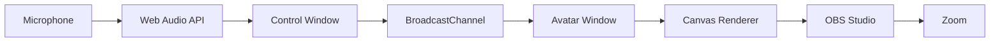

# Kaosan Live

線画イラスト1枚を、
オンライン会議で使える「話すアバター」にするデスクトップアプリ。

Kaosan Live は、マイク音声に合わせて口が動き、自動で瞬きし、待機中も少しだけ揺れる、個人利用向けの線画アバターアプリです。
Zoom などのビデオ会議では、OBS Studio の Window Capture と Virtual Camera を通して利用します。

## 概要

静止画の線画キャラクターを、
会議中に自然に存在しているように見せる。

顔認識やカメラキャプチャは使わず、1枚の画像とマイク音声だけで、口、瞬き、顔全体の微細な動きを表現します。

このアプリ自体は仮想カメラを実装しません。
OBS Studio が Avatar Window をキャプチャし、OBS Virtual Camera として Zoom に渡す構成です。

## コンセプト

自分の代わりに、少しだけ生きている線画キャラクターを会議に置く。

目指している体験:

- 顔出しせずに、会議に「いる」感じを出す
- 派手に動かず、Zoom画面で邪魔にならない
- 1枚の絵を、自分用に細かく調整できる
- 口の動き、瞬き、ゆらぎで静止画感を減らす
- OBSを使えば、Zoom以外の配信・録画にも流用できる

## 機能

### アバター表示

- PNG / JPG / JPEG の線画画像を読み込み
- 画像の表示位置、拡大率、回転を調整
- 1280x720 / 1920x1080 の16:9出力
- 背景色変更
- クロマキー用背景として緑背景を利用可能

### リップシンク

- Web Audio API によるマイク入力
- RMS音量、ピーク音量、周波数傾向を解析
- ノイズゲート
- アタック / リリース制御
- スムージング
- 音量に応じた口の開閉
- A / I / U / O 風の簡易口形ブレンド
- 手動プレビュー用スライダー

### 口の描画

- 口は画像差し替えではなく Canvas のベジェ曲線で描画
- 元画像の口部分を背景色パッチで隠す
- その上に動的な口を重ねる
- 口幅、口高さ、線色、線幅、最大開口、揺らぎを調整

### 瞬き

- 自動ランダム瞬き
- 二連続瞬き
- 瞬き頻度、速度を調整
- 左右の目位置を調整
- 元画像の目をパッチで隠し、閉じ目線を描画

### 顔モーション

- 待機中のゆるい上下揺れ
- 話している間の小さなバウンス
- 瞬き時の軽い沈み込み
- 手描き感になじませる微細な線の揺らぎ

### OBS / Zoom 向け

- OBSでキャプチャするための表示専用 Avatar Window
- Avatar Window にはUIを表示しない
- 30fps / 60fps 切り替え
- 常に最前面
- フルスクリーン
- デバッグ表示

### 設定管理

- 設定JSONの保存
- 設定JSONの読み込み
- 別名保存
- Electron の `userData/settings.json` への通常保存

## 技術

- Electron
- Vite
- TypeScript
- HTML Canvas
- Web Audio API
- BroadcastChannel
- Electron IPC
- JSON settings
- OBS Studio
- OBS Virtual Camera

## 構造 / 設計

Kaosan Live は、設定用の Control Window と、OBSキャプチャ用の Avatar Window に分かれています。



### Control Window

調整・操作用のウィンドウです。

担当:

- 画像選択
- マイク開始 / 停止
- 口、目、顔、背景、出力設定の調整
- 手動リップシンクプレビュー
- 設定保存 / 読み込み
- Avatar Window 起動

主なファイル:

- `src/control.ts`
- `src/audio.ts`
- `src/styles/control.css`

### Avatar Window

OBSでキャプチャするための表示専用ウィンドウです。

担当:

- 背景描画
- 元画像描画
- 口消しパッチ
- 動的な口
- 瞬き
- 顔全体の微細なモーション
- デバッグ表示

主なファイル:

- `src/avatar.ts`
- `src/avatarRenderer.ts`
- `src/styles/avatar.css`

### Electron Main Process

デスクトップアプリとしての土台です。

担当:

- Control Window / Avatar Window の作成
- 設定JSONの読み書き
- 画像選択ダイアログ
- 設定ファイル選択 / 保存ダイアログ
- Avatar Window の最前面、フルスクリーン、サイズ反映
- ローカル画像読み込み用の `kaosan-file://` カスタムプロトコル

主なファイル:

- `electron/main.cjs`
- `electron/preload.cjs`

### 状態同期

Control Window と Avatar Window は `BroadcastChannel("kaosan-live-state")` で設定とリップシンク状態を共有します。

共有される主な状態:

- settings
- lip sync values
- manual preview values

ウィンドウサイズ、フルスクリーン、常に最前面など Electron ネイティブ機能に関わる設定は IPC 経由でも反映します。

## データフロー

1. Control Window で画像と設定を調整する
2. マイク入力を Web Audio API で解析する
3. 音声解析結果から `mouthOpen`, `mouthWide`, `mouthRound`, `talkIntensity` などを生成する
4. BroadcastChannel で Avatar Window に送る
5. Avatar Window の Canvas Renderer が画像、口、瞬き、顔モーションを描画する
6. OBS Studio が Avatar Window を Window Capture する
7. OBS Virtual Camera 経由で Zoom に表示する

## 主要ファイル

```txt
kaosan_live/
├── electron/
│   ├── main.cjs          # Electron main process
│   └── preload.cjs       # Renderer向けIPC API
├── src/
│   ├── audio.ts          # マイク入力と音声解析
│   ├── avatar.ts         # Avatar Window entry
│   ├── avatarRenderer.ts # Canvas描画エンジン
│   ├── bus.ts            # BroadcastChannel
│   ├── control.ts        # Control Window entry
│   ├── defaults.ts       # 既定設定
│   ├── media.ts          # 画像URL変換
│   ├── types.ts          # 型定義
│   └── styles/
├── control.html
├── avatar.html
├── README.md
└── TODO.md
```

## 使い方

### インストール版

配布された `Kaosan-Live-0.1.0-arm64.dmg` を開き、`Kaosan Live` を `Applications` へドラッグします。

Developer IDによる公開用署名・公証を行わないプライベート配布版のため、初回はFinderでアプリを右クリックして `開く` を選択してください。詳しくは `PRIVATE_DISTRIBUTION.md` を参照してください。

### 開発版

```sh
pnpm install
pnpm run dev
```

1. Control Window で `画像選択` を押す
2. 線画イラストを読み込む
3. 口、目、顔位置を調整する
4. `Avatar Window起動` を押す
5. `マイクON` を押す
6. OBS Studio の Window Capture で `Kaosan Live Avatar` を選択する
7. OBS Virtual Camera を開始する
8. Zoom のカメラ設定で `OBS Virtual Camera` を選択する

## 開発

### ツールチェーン

- Node.js: 24.18.0
- pnpm: 11.12.0

### 検証

```sh
pnpm run check
pnpm audit --audit-level moderate
```

### Apple Silicon向け配布物の作成

限定配布用のモデル画像とアイコンはGitに含めません。ローカルの `private-assets/` に次のファイルを配置してから作成します。

```text
private-assets/model.jpeg
private-assets/icon.icns
```

```sh
pnpm run dist:mac
```

DMGとZIPは `release/` に生成されます。

### 開発進捗

次にやることは `TODO.md` に整理しています。

## スクリーンショット

現時点では未追加です。

追加予定:

- Control Window
- Avatar Window
- OBS Window Capture 設定
- Zoom での表示例

## 現在のステータス

初期実装は完了しています。

実装済み:

- Electronアプリ基盤
- Control Window / Avatar Window
- Canvas描画
- 画像読み込み
- ベジェ曲線の口
- マイク解析
- 簡易リップシンク
- 自動瞬き
- 顔モーション
- OBS向け出力設定
- 設定JSON保存 / 読み込み

未確認:

- macOS実機でのGUI起動
- マイク権限ダイアログ後の入力
- OBS Window Capture
- OBS Virtual Camera
- Zoom表示

## ライセンス

未設定です。
